# Emotion Detection System: EmotionSense

*Understand your expression. Reflect. Take a mindful step.*


🌐 **Live Demo:** https://emotiondetectionsystem-13.streamlit.app/

 An end-to-end facial-expression recognition system built with a custom CNN trained on FER-2013, featuring real-time detection, Grad-CAM explainability, confidence analysis, Firebase authentication, and an interactive Streamlit dashboard.


**EmotionSense** has two parts:

1. A **deep-learning facial-expression recogniser**: a custom CNN trained on **FER-2013**, with OpenCV face detection, Grad-CAM explainability and camera-snapshot inference. It was trained and evaluated locally on a CPU-only Windows laptop.
2. A **personal reflection and wellbeing dashboard** in Streamlit, with Firebase accounts, daily check-ins, a journal, a wellbeing toolkit and history insights.

The second part turns a detected expression into an invitation to check in with yourself.

> **Responsible-use note:** EmotionSense classifies **facial expressions** in images. Facial expressions are not a reliable measure of what someone actually feels. It is **not** a medical, psychological, diagnostic or hiring tool, and its wellbeing suggestions are general ideas, not professional advice. See [Ethical considerations](#ethical-considerations).

---

## Overview

| | |
|---|---|
| Task | 7-class facial-expression classification: Angry, Disgust, Fear, Happy, Sad, Surprise, Neutral |
| Data | FER-2013: 35,887 grayscale 48×48 faces, official Training / PublicTest / PrivateTest splits |
| Model | Custom VGG-style CNN, **713k parameters**, 8.7 MB, about 75 ms per webcam frame (detection + prediction) on CPU |
| Headline result | **59.6% accuracy / 0.545 macro F1** on the leakage-aware test set (official test: 60.9% / 0.570) |
| Baseline | Always predicting "Happy": 24.5% accuracy / 0.056 macro F1 |

All numbers in this README come from `results/metrics.json` and `results/training_summary.json`, written by the evaluation and training scripts.

## Features

### Machine learning and computer vision

- **Face detection** with OpenCV's Haar cascade, supporting **multiple faces** per image.
- **Prediction for each face** with confidence, **top-3 alternatives** and the full **7-class probability distribution**.
- **Confidence bands** (High ≥ 70%, Moderate 40–70%, Low < 40%) with a gentle low-confidence warning. The thresholds are checked against validation accuracy (see [Results](#results)).
- **Grad-CAM** "model attention" heatmap for every detected face.
- **Camera snapshots** from the browser, analysed exactly like uploaded photos.
- **Leakage-aware evaluation:** FER-2013's cross-split duplicate images are detected and reported transparently.

### EmotionSense app

- **Accounts:** Firebase email/password sign-up, login, logout and password reset. There's also a **guest mode** that saves nothing beyond the browser session.
- **Dashboard:** a large *Current emotion* card (emoji, name, confidence ring and badge) with the probability bars, today's check-in status, streak, *Recommended for you*, recent activity and quick actions.
- **Detect Emotion:** drop a photo or take a camera snapshot. You get the annotated image next to a large result card, an *Emotion distribution* of all seven expressions, ranked *Top 3 predictions*, Grad-CAM, *What you can do next* and **Save check-in**. The image itself is never stored.
- **Daily Check-In:** five mood cards, selectable factor chips and an optional written reflection (*Want to put it into words?*).
- **Wellbeing toolkit:** *Feeling overwhelmed?* small resets and 8 activity cards, including journaling with prompts, a breathing guide (INHALE · HOLD · EXHALE with a countdown), step-by-step 5-4-3-2-1 grounding and timers. Each ends with a *How do you feel after this?* reflection.
- **History & Insights:** charts and rule-based insights that keep the **model signal** (detected expressions) clearly apart from **self-reported mood**. You can delete one entry or all your data.
- **Model Insights:** the full evaluation story, including why accuracy isn't enough and the leakage-aware results.
- **Clean, light design:** white cards, one indigo accent, subtle shadows and minimal motion (switched off for *reduce motion*), plus a per-emotion colour system. Fear, Surprise, Sad and Neutral are hard to tell apart with colour-vision deficiency, so every emotion is always shown with its **emoji and name** too.

## Screenshots

These are captured from the running app in headless Chrome (guest mode).

| Landing | Dashboard |
|---|---|
| 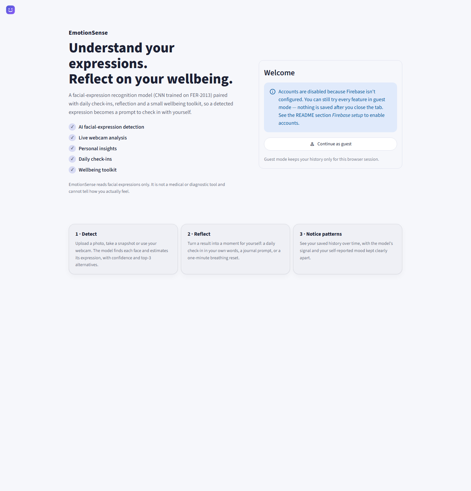 | 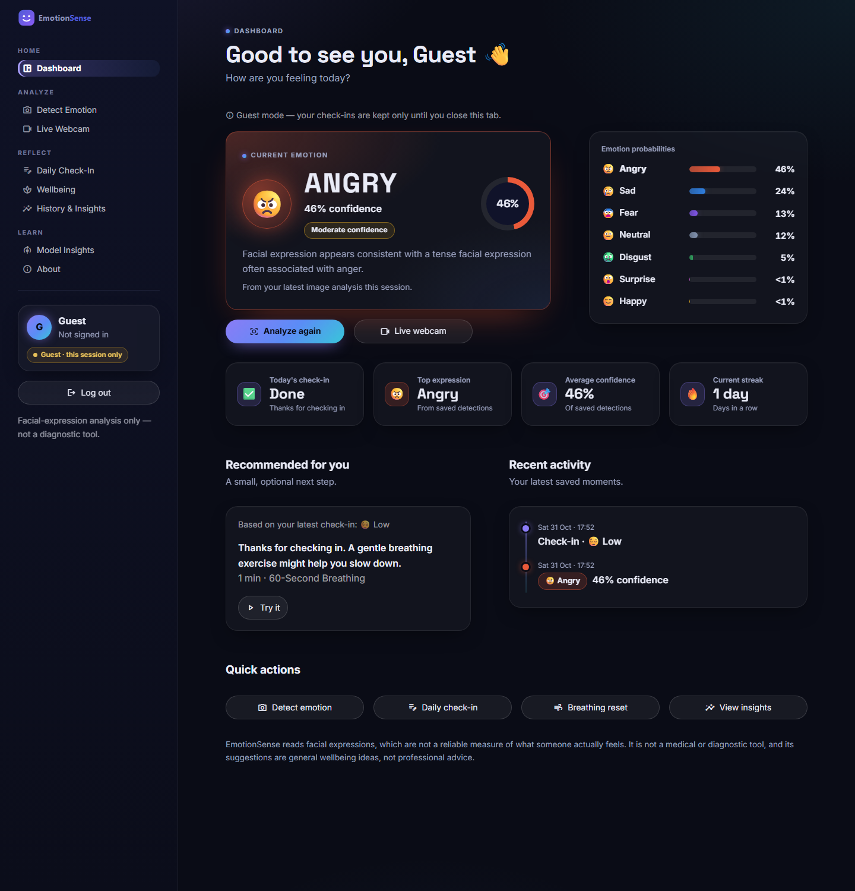 |
| **Detect Emotion** (multi-face upload) | **Detect Emotion**: top 3, Grad-CAM, next steps |
| 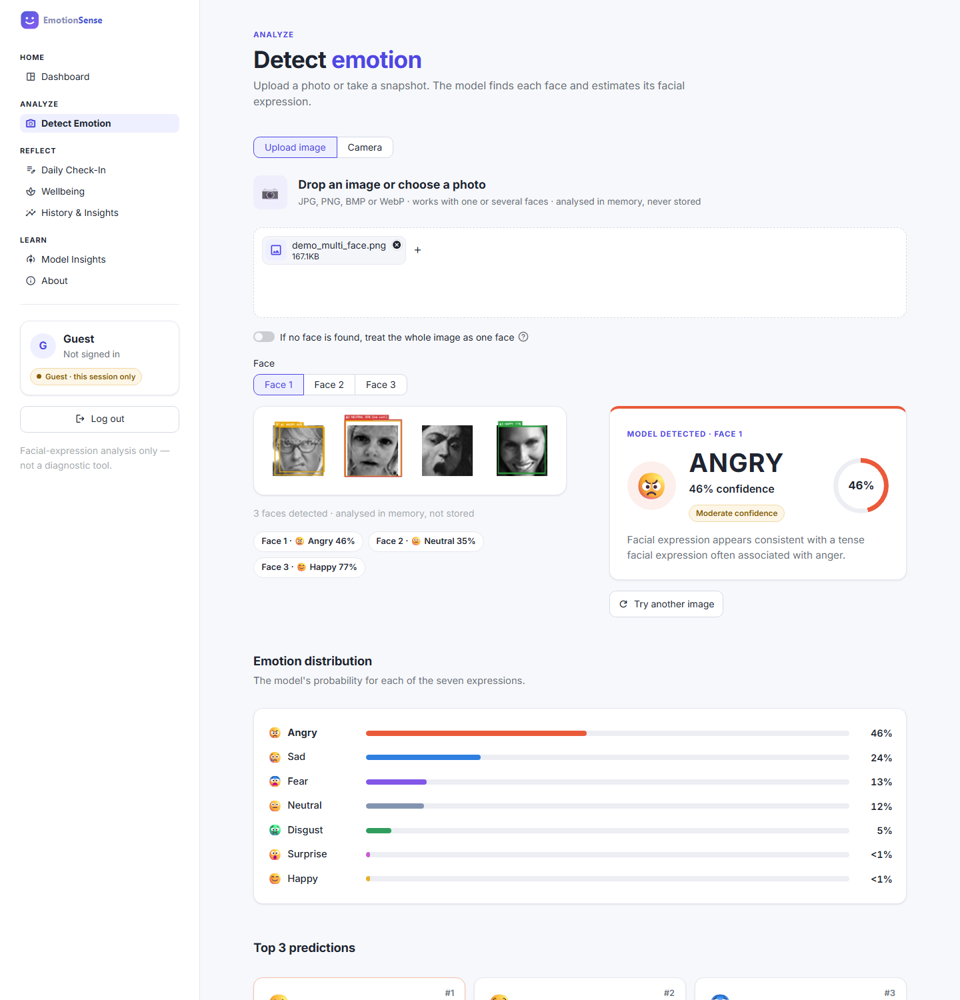 | 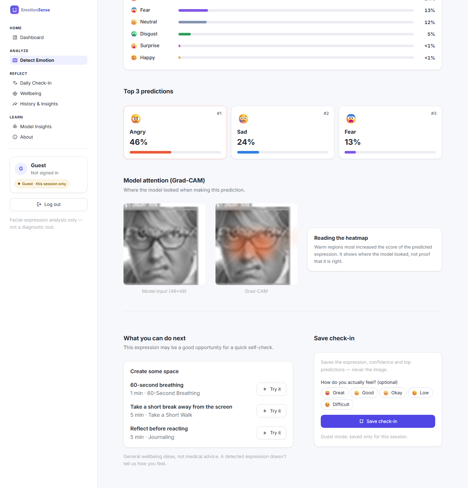 |
| **Daily Check-In** | **Wellbeing** |
| 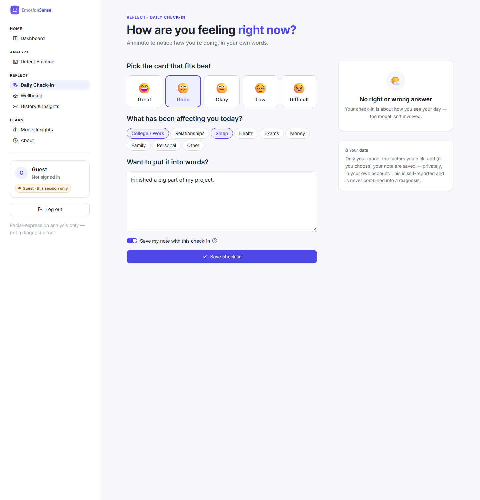 | 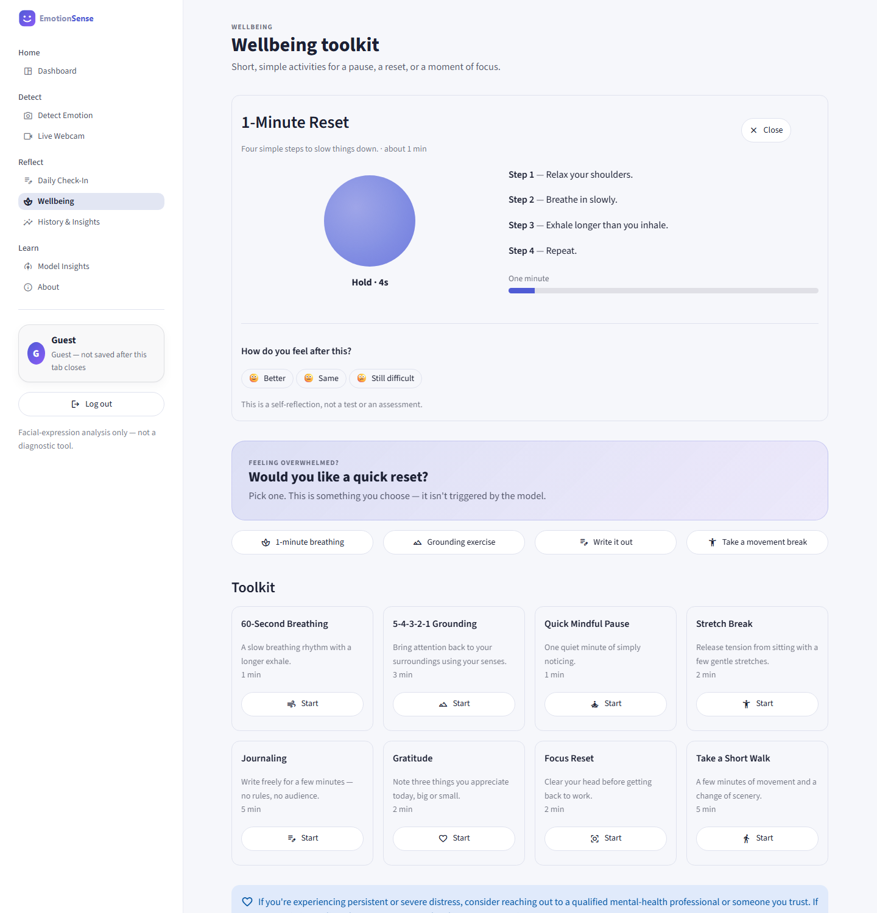 |
| **History & Insights** | **Model Insights** |
| 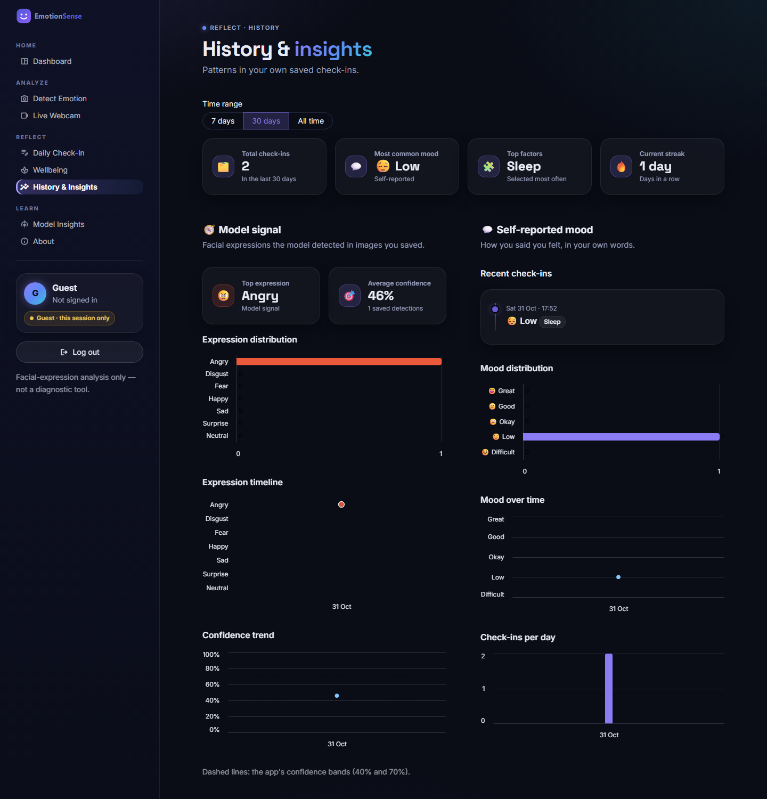 | 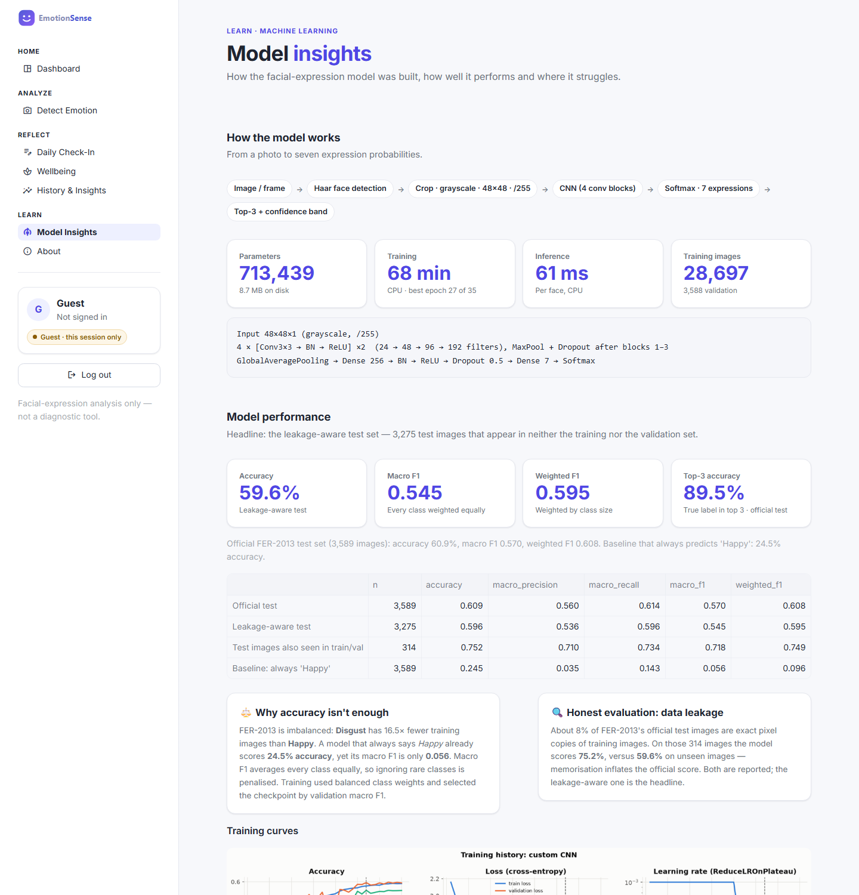 |
| **Detect Emotion**: camera snapshot | **Inference pipeline output** (`src/predict.py`) |
| 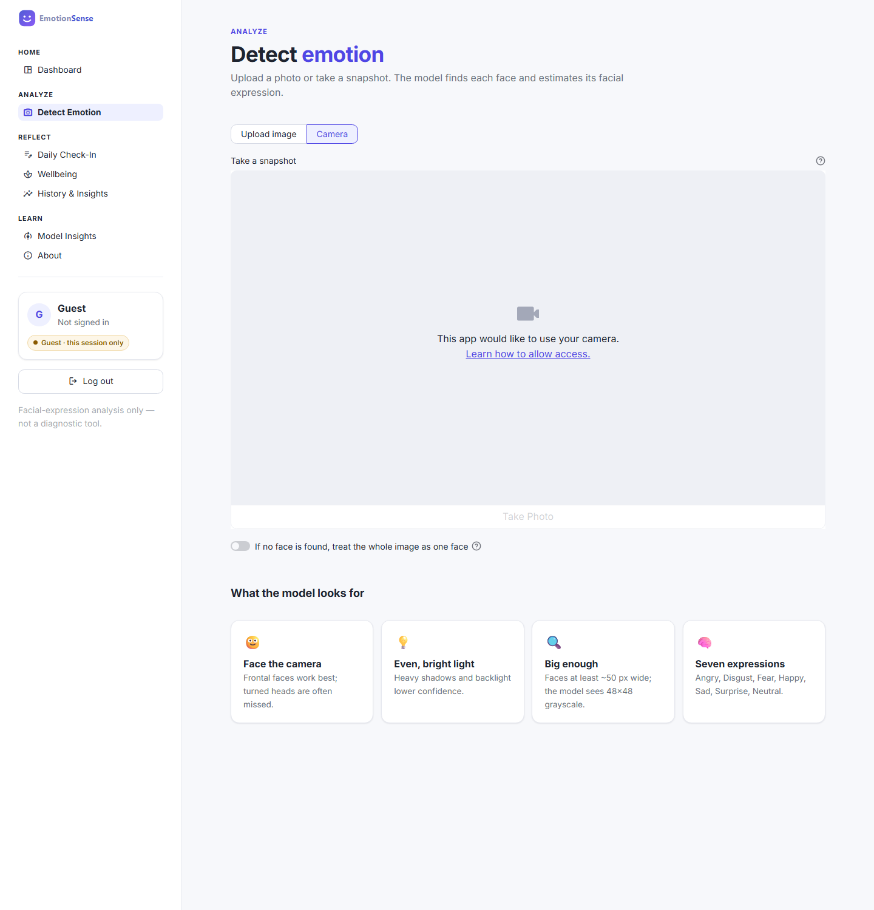 |  |

The pipeline demo uses four FER-2013 test faces the model never saw during training. The third face is turned sharply and is **missed by the frontal Haar detector**. This is a real limitation, shown deliberately.

## Tech stack

Python 3.13 · TensorFlow 2.21 / Keras 3 · OpenCV 4.14 · NumPy · pandas · scikit-learn · Matplotlib · Streamlit 1.66 (Altair charts) · Firebase Authentication and Cloud Firestore (REST API via `requests`) · pytest

> OpenCV is pinned to `<5` because OpenCV 5 removed `cv2.CascadeClassifier` and its bundled Haar-cascade files.

## Dataset

**FER-2013** (Goodfellow et al., 2013). The dataset is **not committed**; see [`data/README.md`](data/README.md) for download instructions. In short, `python -m src.data_loader --download` fetches a public mirror of the original splits. The class counts were verified to match the original challenge exactly.

| Split (official name) | Used as | Images |
|---|---|---|
| Training | train | 28,709 |
| PublicTest | validation | 3,589 |
| PrivateTest | test | 3,589 |

### FER-2013 class distribution

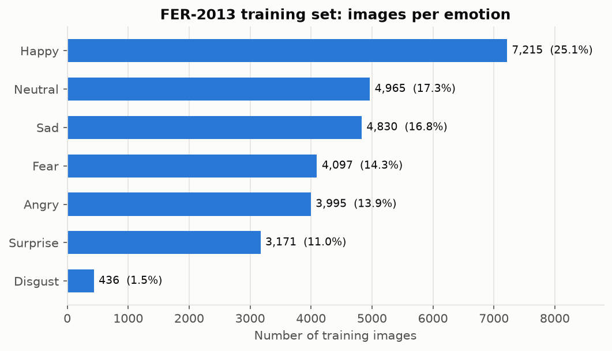

**Disgust is 16.5× rarer than Happy** (436 vs 7,215 training images). A model can ignore Disgust entirely and still reach high accuracy, so this project uses class weights and reports **macro F1**.

### Data-quality findings and the leakage issue

The EDA (`notebooks/eda_and_model_analysis.ipynb`) found two problems:

1. **13 near-blank images** with no face: 12 black and 1 grey, but all labelled. They are excluded from train and validation at load time; the files are never modified.
2. **Exact duplicate images across splits**, checked by MD5 hash and then confirmed pixel by pixel:

| Overlap | Images | Share |
|---|---|---|
| Test images also in train | 288 | 8.0% of test |
| Validation images also in train | 279 | 7.8% of validation |
| Test images also in validation | 44 | 1.2% of test |

A model can memorise a duplicated training image, which inflates test scores. The project **keeps the official splits** but reports **two evaluations**:

- **Official test**: all 3,589 images, comparable with published FER-2013 results.
- **Leakage-aware test**: 3,275 images, excluding every test image found in train *or* validation. Validation is excluded too because it drives early stopping and checkpoint selection.

The inflation is measurable. On the 314 leaked test images the model scores **75.2%** accuracy, compared with **59.6%** on unseen images.

## Data preprocessing

One function, `to_model_input`, is used everywhere: training, evaluation and the app.

```
face crop → grayscale → resize to 48×48 (INTER_AREA) → divide by 255 → shape (48, 48, 1)
```

**Training-only augmentation** (inside the `tf.data` pipeline; validation and test are never augmented):
horizontal flip, ±10° rotation, 10% zoom, 10% shift, and ±10% brightness and contrast. The photometric jitter was added because the EDA showed **mean brightness differs by class** (Surprise 146 vs Sad 121), a shortcut the model should not learn.

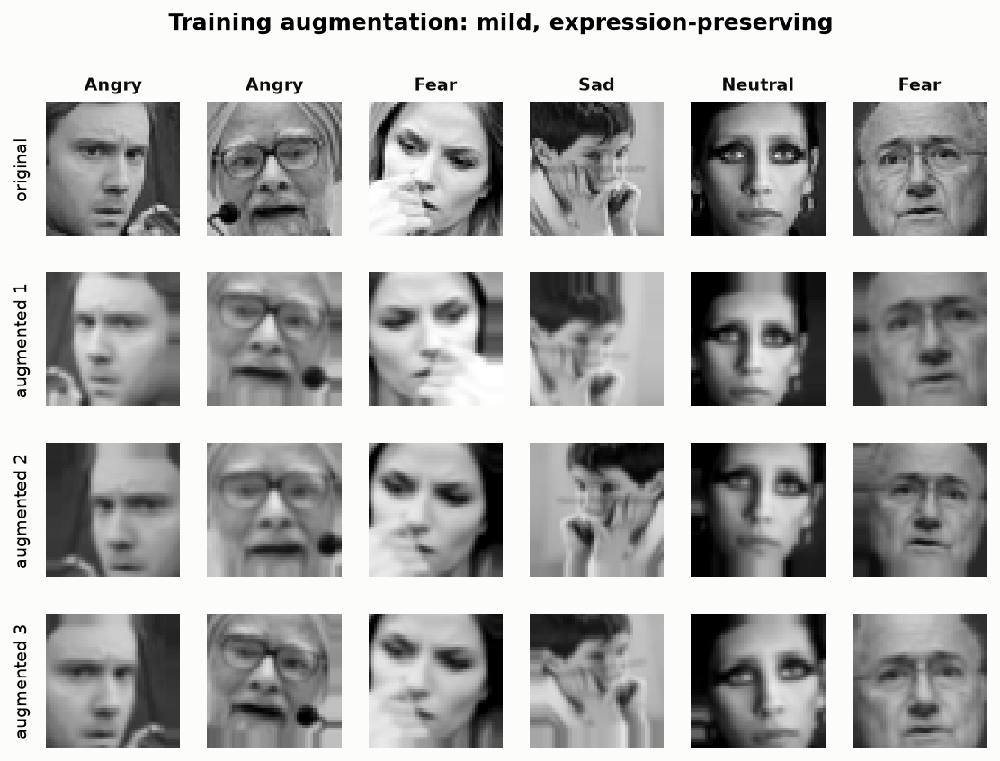

## Model architecture

```
Input 48×48×1
Block 1: [Conv 3×3, 24  → BatchNorm → ReLU] ×2 → MaxPool → Dropout 0.20   → 24×24
Block 2: [Conv 3×3, 48  → BatchNorm → ReLU] ×2 → MaxPool → Dropout 0.25   → 12×12
Block 3: [Conv 3×3, 96  → BatchNorm → ReLU] ×2 → MaxPool → Dropout 0.30   → 6×6
Block 4: [Conv 3×3, 192 → BatchNorm → ReLU] ×2                             → 6×6  (Grad-CAM layer)
GlobalAveragePooling → Dense 256 → BatchNorm → ReLU → Dropout 0.5 → Dense 7 → Softmax
```

**Design choices:**

- Two stacked 3×3 convolutions cover a 5×5 region with fewer parameters than a single 5×5 convolution.
- Global average pooling replaces a large Flatten→Dense layer, which keeps the model at 713k parameters.
- The filter widths were chosen with a **CPU benchmark**: a 32-64-128-256 version took about 156 s per epoch, while 24-48-96-192 took about 97 s.

**Transfer learning was not trained.** A MobileNetV2 comparison was considered. On this CPU it would have needed roughly another hour of training, plus upscaling the 48×48 grayscale inputs to 3-channel 96×96. That was judged not worth the cost, so the custom CNN is the only model, and it remains fully explainable.

## Training strategy

| Setting | Value |
|---|---|
| Optimizer | Adam, learning rate 1e-3 |
| Loss | Sparse categorical cross-entropy with **balanced class weights** |
| Batch / max epochs | 64 / 50 |
| Model selection | **Validation macro F1** (custom callback); the test set is never used |
| Callbacks | ReduceLROnPlateau (val loss, ×0.5, patience 3), EarlyStopping (val macro F1, patience 8, restore best), ModelCheckpoint |
| Result | **35 epochs, best epoch 27, 67.8 min on CPU** (about 95–100 s per epoch; one epoch was slowed to 747 s by battery throttling) |

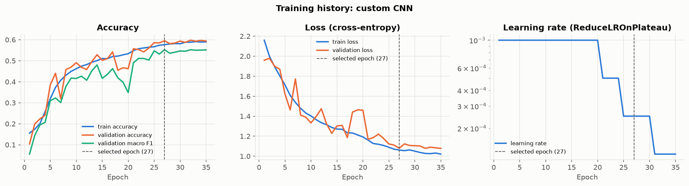

- **Slow start:** in epochs 1–4 the predictions briefly collapse onto one class. This comes from heavy regularisation, BatchNorm warm-up and the 9.4× Disgust weight.
- **Learning-rate reductions** at epochs 21 and 25 each produced a clear jump in macro F1: 0.480 → 0.511 → 0.553.
- **No overfitting:** training accuracy stays at or below validation accuracy. Training metrics are measured with dropout and augmentation active.
- **Early stopping** ended training at epoch 35 and restored the epoch-27 weights.

## Class imbalance handling

Class weights are computed **from training labels only** as *n / (k · n_c)*:

| Angry | Disgust | Fear | Happy | Sad | Surprise | Neutral |
|---|---|---|---|---|---|---|
| 1.03 | **9.40** | 1.00 | 0.57 | 0.85 | 1.29 | 0.83 |

**Effect:** Disgust reaches **0.75 recall** despite being 1.5% of the data. The cost is low precision (0.32): the model over-predicts Disgust. That is a deliberate trade-off in favour of macro F1. No oversampling was used, and validation and test are untouched.

## Evaluation metrics

Accuracy alone is misleading on imbalanced data, so the project reports accuracy, macro precision, recall and F1 (every class weighted equally), weighted F1, per-class metrics and confusion matrices. Everything is produced by `python -m src.evaluate`.

## Results

| Evaluation | Images | Accuracy | Macro precision | Macro recall | **Macro F1** | Weighted F1 |
|---|---|---|---|---|---|---|
| **Official FER-2013 test** | 3,589 | **60.9%** | 0.560 | 0.614 | **0.570** | **0.608** |
| **Leakage-aware test** | 3,275 | **59.6%** | 0.536 | 0.596 | **0.545** | **0.595** |
| Leaked test images only | 314 | 75.2% | 0.710 | 0.734 | 0.718 | 0.749 |
| Baseline: always "Happy" (official test) | 3,589 | 24.5% | 0.035 | 0.143 | 0.056 | 0.096 |

Top-3 accuracy on the official test set is **89.5%**. For context, human accuracy on FER-2013 is estimated at about 65 ± 5% because of label noise.

### Per-class performance (official test)

| Expression | Precision | Recall | F1 | Support | F1 (leakage-aware) |
|---|---|---|---|---|---|
| Happy | 0.894 | 0.779 | **0.833** | 879 | 0.833 |
| Surprise | 0.687 | 0.803 | **0.741** | 416 | 0.692 |
| Neutral | 0.548 | 0.705 | 0.617 | 626 | 0.607 |
| Angry | 0.569 | 0.438 | 0.495 | 491 | 0.482 |
| Sad | 0.480 | 0.503 | 0.491 | 594 | 0.488 |
| Disgust | 0.318 | 0.746 | 0.446 | 55 | 0.354 |
| Fear | 0.427 | 0.326 | **0.370** | 528 | 0.358 |

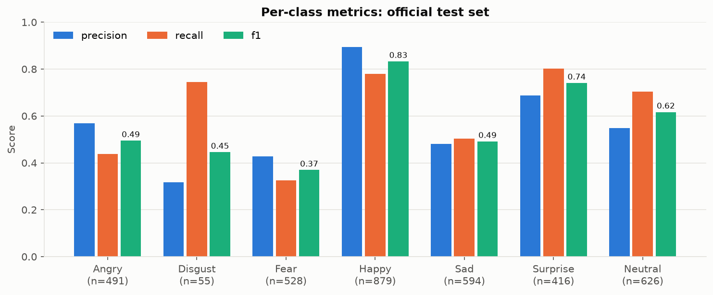

## Confusion matrix

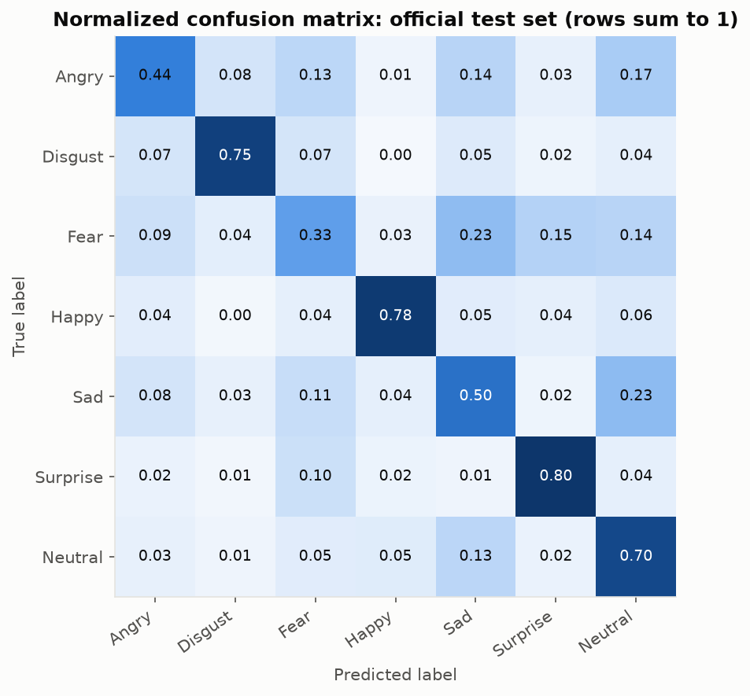

- **Fear** is the hardest class. It is confused with Sad (23%), Surprise (15%) and Neutral (14%).
- **Sad ↔ Neutral** is the main two-way confusion: 23% of Sad faces are predicted Neutral, and 13% of Neutral faces are predicted Sad.
- **Happy** and **Surprise** are easiest because of their distinctive mouth shapes.

Raw counts are in `results/confusion_matrix.png`; the full report is in `results/classification_report.txt`.

### Are the confidence bands meaningful? (validation set)

| App band | Share of predictions | Accuracy in band |
|---|---|---|
| High (≥ 70%) | 35.5% | 84.8% |
| Moderate (40–70%) | 44.4% | 50.0% |
| Low (< 40%) | 20.0% | 35.6% |

The bands separate reliable predictions from unreliable ones. They are still **application heuristics**, not calibrated certainty.

## Grad-CAM / Explainability

Grad-CAM weights the last convolutional feature map (`block4_2_relu`, 6×6) by the gradient of the predicted class score. Orange marks the regions that **increased** that score.

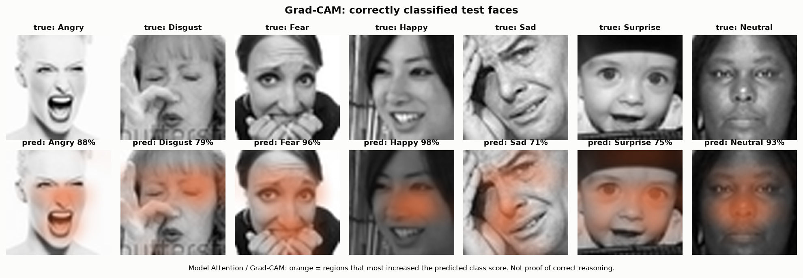
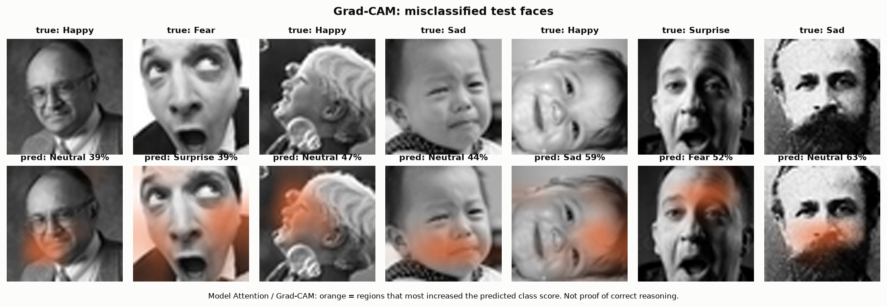

- **Correct predictions** focus on the mouth and eyes: the open mouth for Angry and Fear, the smile for Happy, the eyes for Surprise.
- **Several misclassifications** attend to hair, background or a beard, which helps explain the error.
- Grad-CAM shows **where the model looked**. It does not prove the model's reasoning is correct. The heatmap is coarse (6×6) and says nothing about what a person feels.

## EmotionSense application

### Pages

| Section | Page | What it does |
|---|---|---|
| Home | **Dashboard** | Greeting, *Current emotion* card with probability bars, today's check-in status, streak, *Recommended for you*, recent activity, quick actions |
| Analyze | **Detect Emotion** | Upload or camera snapshot, then face boxes, result card, emotion distribution, ranked top-3, Grad-CAM, suggestions, *Save check-in*, *Try another image* |
| Reflect | **Daily Check-In** | Mood (😄 Great to 😣 Difficult), factors and an optional written reflection |
| Reflect | **Wellbeing** | *Feeling overwhelmed?* quick resets, 8 toolkit activities (including journaling with prompts), *How do you feel after this?* |
| Reflect | **History & Insights** | Time-range filter; **model signal** and **self-reported mood** charts side by side; rule-based insights; activity table; delete data |
| Learn | **Model Insights** | Leakage-aware and official metrics, *why accuracy isn't enough*, architecture, curves, confusion matrices, per-class metrics, Grad-CAM |
| Learn | **About** | How it works, technology, limitations, privacy |

The *Camera* option on Detect Emotion uses the browser's camera, so it works both locally and when the app is hosted. The dashboard's **Use camera** button opens it directly.

### Architecture

```
Browser ── Streamlit (app.py) ── src/ui/views/*  (one module per page)
                │                     │
                │                     ├── src/predict.py ─ face_detector · preprocessing · CNN · gradcam
                │                     ├── src/wellbeing.py  (suggestions, activities, prompts)
                │                     └── src/analytics.py  (stats, streaks, rule-based insights)
                │
                └── src/ui/state.py ── src/storage.py ─┬─ SessionHistoryStore   (guest: in-memory only)
                                                       └─ FirestoreHistoryStore ─ src/firebase_client.py
                                                                                     │  REST + user's ID token
                                                                          Firebase Auth · Cloud Firestore
```

- **No backend server and no service account.** The app calls Firebase's REST API **as the signed-in user**, with their own ID token. Firestore **security rules** therefore decide what each user can access.
- **The ML pipeline is unchanged.** The UI only calls `EmotionPredictor.analyze()` and `GradCAM`.

### Firebase setup

Accounts are optional; without Firebase the app runs in guest mode. To enable them:

1. Create a project at <https://console.firebase.google.com>.
2. Go to **Build → Authentication → Sign-in method** and enable **Email/Password**.
3. Go to **Build → Firestore Database** and create a database in **production mode**.
4. In **Firestore → Rules**, paste the contents of [`firestore.rules`](firestore.rules) and publish. With the Firebase CLI you can instead run `firebase deploy --only firestore:rules`.
5. In **Project settings → General**, copy the **Web API key** and **Project ID** into `.streamlit/secrets.toml`:

   ```bash
   copy .streamlit\secrets.toml.example .streamlit\secrets.toml     # then edit the two values
   ```

   ```toml
   [firebase]
   api_key = "YOUR_FIREBASE_WEB_API_KEY"
   project_id = "your-firebase-project-id"
   ```

   Alternatively, set the environment variables `FIREBASE_API_KEY` and `FIREBASE_PROJECT_ID`.

`secrets.toml` is git-ignored. The Web API key only identifies the project to Firebase; data access is controlled by the security rules. No admin or service-account credentials are used anywhere.

### Data model and security rules

```
users/{uid}/checkins/{checkinId}
    userId, kind ("detection" | "checkin" | "journal" | "reset"), timestamp (UTC ISO-8601)
    detection: detectedEmotion, confidence, topPredictions[{emotion, probability}], source, selfReportedMood?
    checkin:   selfReportedMood, moodFactors[], journalText?   (the note is saved only if the user keeps the toggle on)
    journal:   prompt, journalText
    reset:     activity, feelingAfter
```

[`firestore.rules`](firestore.rules) works as follows:

- A user can **read, create and delete only under their own `users/{uid}` path**.
- Each new entry must carry the user's own `userId` and a known `kind`.
- Entries can't be edited after creation.
- Everything else is denied.

**Privacy:**
- Uploaded images and webcam frames are **never stored**; they're analysed in memory and discarded.
- Only the fields listed above are saved, and only when the user presses **Save**.
- Users can delete one entry or all their history from **History & Insights**.

### Wellbeing wording

- The app describes **expressions** ("Your facial expression appears…", "The model detected…"), never feelings or conditions.
- A test (`tests/test_wellbeing.py`) scans all user-facing source for diagnostic phrases such as "you are stressed" or "you have anxiety".
- Suggestions are general wellbeing ideas, labelled as *not medical advice*.
- The Wellbeing page always shows a note about reaching out to a qualified professional or someone you trust.

## Web version (Next.js on Vercel)

A second front end in [`web/`](web/README.md), separate from the Streamlit app (which is unchanged): Next.js +
TypeScript with landing, login/sign-up, dashboard, detect (upload and webcam), history and about pages.

- **Inference runs in the browser.** The same trained weights, converted to TensorFlow.js without retraining, run with
  OpenCV.js for face detection and preprocessing. No Python server, Docker image or paid service is needed, and images
  never leave the user's device. The whole app deploys to Vercel as static pages.
- **Same predictions as Python.** The browser pipeline reproduces `src/` step by step. On 44 real faces it gives
  identical model inputs, probabilities within 3.3 × 10⁻⁷, the same predicted emotion every time, and Grad-CAM
  heatmaps within 3 × 10⁻⁶.
- **Shared history:** same Firebase project and `users/{uid}/checkins` format, so predictions saved in either app
  appear in both. The existing `firestore.rules` apply unchanged.
- [`inference_api/`](inference_api/README.md) is an optional FastAPI + Docker server version of the same pipeline.
  The web app does not use it.

## Project structure

```
Emotion_Detection_System/
├── app.py                      # Streamlit entry point: theme, sign-in gate, navigation
├── web/                        # Next.js web app for Vercel (see web/README.md)
├── inference_api/              # optional FastAPI + Docker server for the same pipeline (not used by web/)
├── src/
│   ├── config.py               # paths, labels, hyperparameters, thresholds, colours, Firebase settings
│   ├── data_loader.py          # FER-2013 loading (+ --download), .npz cache
│   ├── data_quality.py         # blank images, cross-split duplicates, leakage-aware mask
│   ├── preprocessing.py        # to_model_input, augmentation, tf.data, class weights
│   ├── model.py                # custom CNN
│   ├── train.py                # training with macro-F1 model selection
│   ├── evaluate.py             # official + leakage-aware metrics, plots
│   ├── face_detector.py        # Haar cascade detection + padded crops
│   ├── predict.py              # inference pipeline, error types, annotation
│   ├── gradcam.py              # Grad-CAM + example grids
│   ├── firebase_client.py      # Firebase Auth + Firestore over REST (user-scoped)
│   ├── storage.py              # history entries; Firestore and guest-session stores
│   ├── wellbeing.py            # suggestions, activities, check-in options, journal prompts
│   ├── analytics.py            # session summary, history stats, streaks, insights
│   ├── utils.py                # plot style, figure saving
│   └── ui/
│       ├── theme.py            # global CSS: light design system
│       ├── components.py       # cards, result card, charts, activities
│       ├── state.py            # sign-in state, token refresh, history store, routing
│       ├── resources.py        # cached model + Grad-CAM
│       └── views/              # landing, dashboard, detect, checkin, toolkit, history, model_insights, about
├── .streamlit/
│   ├── config.toml             # light theme, font
│   └── secrets.toml.example    # Firebase config template (real secrets.toml is git-ignored)
├── firestore.rules             # per-user Firestore security rules
├── assets/                     # logo + icon (SVG)
├── docs/screenshots/           # screenshots of the running app
├── notebooks/eda_and_model_analysis.ipynb
├── tests/                      # pytest: ML pipeline, Firebase client, wellbeing/analytics, app pages and auth
├── models/emotion_model.keras  # trained model (8.7 MB)
├── results/                    # metrics, reports, figures, Grad-CAM examples
├── data/README.md              # dataset instructions (data itself is git-ignored)
├── requirements.txt
└── LICENSE
```

## Installation

```bash
git clone https://github.com/Kashish-13/Emotion_Detection_System.git
cd Emotion_Detection_System
python -m venv .venv
.venv\Scripts\activate            # Windows   (macOS/Linux: source .venv/bin/activate)
pip install -r requirements.txt
```

Tested with Python 3.13 on Windows 11, CPU only.

## How to run locally

The trained model is included in `models/emotion_model.keras`, so the app runs without the dataset:

```bash
streamlit run app.py
```

Choose **Continue as guest**, or configure Firebase (see [Firebase setup](#firebase-setup)) to enable accounts and saved history.

To reproduce the ML pipeline:

```bash
python -m src.data_loader --download   # get FER-2013 (~136 MB) and verify class counts
python -m src.data_quality             # leakage report  -> results/data_leakage_report.json
python -m src.train                    # train the CNN   -> models/emotion_model.keras (~1 h on CPU)
python -m src.evaluate                 # metrics/plots   -> results/
python -m src.gradcam                  # Grad-CAM grids  -> results/gradcam/
python -m src.predict path/to/photo.jpg --save annotated.jpg
```

Open `notebooks/eda_and_model_analysis.ipynb` with the `.venv` interpreter selected as the kernel.

## How to run tests

```bash
pytest -q
```

There are 98 tests, and none of them need a network connection or a real Firebase project.

| File | Covers |
|---|---|
| `test_preprocessing.py` | Labels, input shape and range, class weights, deterministic validation pipeline, blank and leakage masks |
| `test_inference.py` | Prediction format, probabilities summing to 1, top-3, confidence bands, low-confidence warning, no-face, invalid image, missing or corrupt model, multi-face on real FER faces, Grad-CAM |
| `test_firebase.py` | Auth request payloads, friendly errors, Firestore failures reported as `CloudStorageError`, malformed replies, token refresh, Firestore encoding, **every request scoped to `users/{own uid}`**, path-escape protection, per-user data isolation |
| `test_wellbeing.py` | Suggestion and activity coverage, non-diagnostic wording scan, storage (no image data saved), streaks, stats, insights |
| `test_persistence.py` | Firestore up and down: saves go to exactly one place (no duplicates), local fallback, loading, retry window, deletes, journal and check-in end to end, every page renders without Firestore |
| `test_app.py` | Every page renders; navigation; guest flow; daily check-in submission; wellbeing activity and reflection; history deletion; **sign-up → logout → wrong password → login → password reset** against an in-memory fake Firebase |

Tests that need the dataset or the model skip themselves if those files are absent.

## Limitations

**Model**
- **Accuracy ceiling:** about 60% on unseen test faces. Fear, Sad, Angry and Disgust are often confused.
- **Disgust estimates are noisy:** only 55 test images (38 leakage-aware). The model also over-predicts Disgust because of its class weight.
- **Frontal faces only:** the Haar detector misses turned or tilted faces and can produce false positives on textured backgrounds.
- **Domain gap:** the model was trained on 48×48 grayscale web photos with posed expressions. Real webcam conditions (lighting, pose, glasses, masks) reduce accuracy.
- **Leakage handling covers exact duplicates only.** Near-duplicates are not detected.
- **Augmentation artifacts:** shifted training images smear edge pixels (`fill_mode="nearest"`).

**App**
- **Sign-in doesn't survive a browser refresh.** Streamlit keeps it in the session, so you log in again after reloading.
- **Firestore is optional.** Firebase Authentication is required for accounts, but if Firestore isn't set up or can't be reached, the app keeps working: entries are saved locally for the current session and appear in History as usual. This happens silently; no cloud status is shown in the UI. After a failure the app waits 60 seconds before trying Firestore again, so pages don't stall. Local entries are **not** uploaded later automatically, and they are cleared when you log out or close the tab.
- **No live video stream.** The camera takes single snapshots; there is no continuous live-webcam page.
- **Rules weren't run in the emulator.** The Firebase flows were tested against a fake backend, and the security rules were not executed in the Firebase emulator, which needs Java. Before real use, check them in the Firebase console's **Rules Playground**.
- **Insights are simple rule-based summaries** of the user's own data, not statistical or clinical analysis.

## Ethical considerations

- **Expressions are not emotions.** A smile is not proof of happiness, and expressions vary by culture, individual and context.
- The model must **not** be used to diagnose mental health, judge honesty, screen job candidates, monitor students or employees, or infer personality.
- FER-2013's **demographic composition is undocumented**, and performance across groups has **not been audited**. It may be uneven.
- FER-2013 labels are noisy (some duplicated images carry different labels), so the labels themselves are imperfect.
- The app uses wording such as *"detected facial expression"*, never *"you are feeling…"*. It keeps model output separate from self-reported mood, and processes images and webcam frames in memory without storing them.
- Wellbeing features are self-reflection tools. They are never triggered or scored by the model, and the app points to qualified professionals for persistent or severe distress.

## Future improvements

- A larger CNN or a pretrained backbone (ResNet or EfficientNet on a GPU), and a fair comparison under the same leakage-aware protocol.
- Label smoothing or mixup for noisy labels, test-time augmentation, and probability calibration (temperature scaling).
- A DNN face detector (for example OpenCV YuNet) for better recall on non-frontal faces.
- Perceptual-hash near-duplicate detection, plus a fairness audit on a demographically annotated dataset.

## Author

**Kashish Arya**: [github.com/Kashish-13](https://github.com/Kashish-13)

Licensed under the [MIT License](LICENSE).
